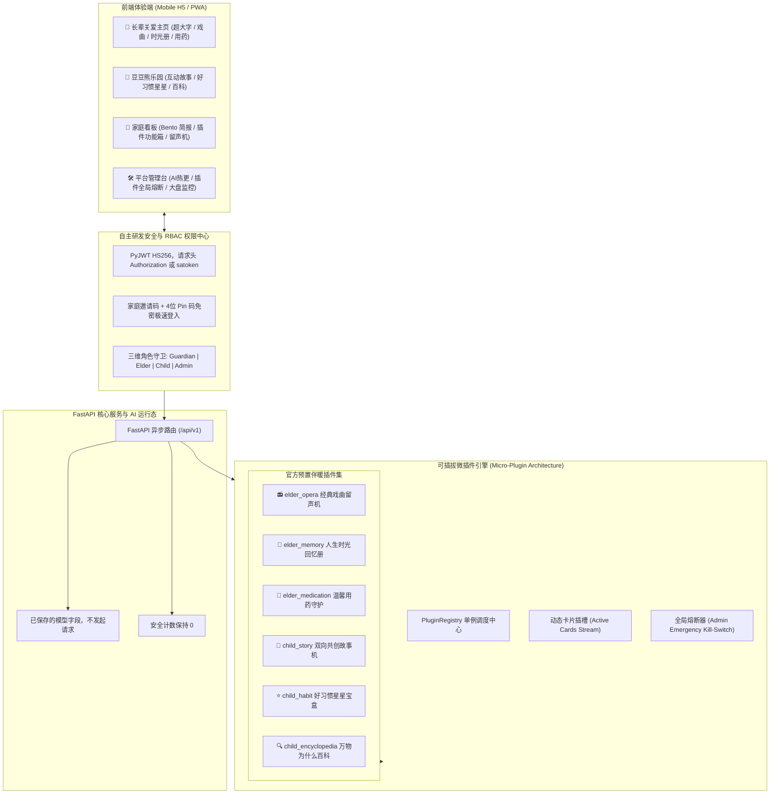

# 「伴暖」WarmCompanion · 家庭一老一小双模温情陪伴平台

<div align="center">


**一个 FastAPI 家庭空间：守护者注册、邀请码加 Pin、六个固定文案插件，数据在 SQLite。**  
页面通过正在运行的服务打开。没有接入大模型或 Edge-TTS。

[🔑 独立登录与注册门户](prototype/login.html) · [📱 手机端体验原型](prototype/index.html) · [🛠️ 平台管理控制台](prototype/admin.html) · [📖 产品需求文档 (PRD)](docs/PRD_FAMILY_COMPANION.md)

</div>

---

## 📖 项目愿景与背景

随着现代家庭工作与生活节奏加快，核心中青年群体的双向照料压力剧增：
- **银发长辈**：独自居家、缺乏倾诉交流、容易遗漏慢病用药、视力听力衰退、对复杂菜单有天然畏难心理；
- **幼童宝贝**：渴望耐心睡前故事与好奇心百科解答、需要好习惯正向引导激励、对网络有害内容高度敏感；
- **家庭守护者**：工作繁忙，亟需轻量低干扰、高价值的每日老幼陪伴全景简报，并能随时远程留言与配置提醒。

**「伴暖」(WarmCompanion)** 是一个 FastAPI 进程加三张静态页。身份来自注册时的角色（`guardian` / `elder` / `child`），不是页面上的生日选择器。家庭、成员、设置、插件开关和插件进度写在 SQLite。

---

## 🌟 核心功能特色

### 1. 长辈页
- 角色是 `elder`。卡片来自 `GET /api/v1/plugins/active`。
- `elder_opera` 在三首固定曲目之间切换，进度写入数据库。没有音频文件。
- `elder_memory` 把口述文字按家庭和成员存进 SQLite，重启后还在。提示语是固定的。
- `elder_medication` 记录一次打卡。守护者关掉用药提醒后，打卡会被拒绝。没有推送，也没有发给家人。
- 底部麦克风不会识别语音。朗读用的是浏览器 `speechSynthesis`。

### 2. 儿童页
- 接口角色是 `child`（不是 `kids`）。
- `child_story` 只有写好的两幕，选择会保存。不会调用模型续写。
- `child_habit` 把三颗星的勾选写入数据库。
- `child_encyclopedia` 是固定句子，没有音频。
- `kids_curfew_enabled` 可以保存。到点不会自动把故事静音。

### 3. 守护者
- 注册、登录、按 `family_id` 列出成员、添加 / 修改 / 删除长辈或儿童。
- 插件开关和看护两个布尔值合并进家庭 settings，不会清掉另一边。
- 没有心情指数、对讲分钟数或亲情便签接口。那些旧文案已从主页藏掉。

### 4. 管理页
- `POST /api/v1/admin/login` 使用 `ADMIN_USERNAME` / `ADMIN_PASSWORD`。家庭令牌访问管理接口是 403。
- 大盘数字来自 `GET /api/v1/admin/dashboard/stats`。没有模型调用时，对话数和安全告警是 0。
- 模型服务商、提示词可以写入 SQLite。这个进程不会用它们发请求。
- 插件全局开关会持久化。关掉之后，家庭端卡片消失，动作返回 403。

---

## 🏗️ 核心架构与工程设计



### 1. PyJWT
- 令牌是 PyJWT HS256，默认 30 天。`satoken` 头和 `Authorization: Bearer` 接受同一枚 JWT，这不是服务端会话。
- 每次请求按 `sub` 查 SQLite。用户被删除后，旧令牌返回 401。没有注销接口，未删除的令牌在过期前仍然有效。
- 密码和 Pin 用 PBKDF2-HMAC-SHA256。邀请码用 `secrets`。
- 平台 `admin` 只能从 `POST /api/v1/admin/login` 签发。成员创建只接受 `elder` 和 `child`。

### 2. 可插拔微插件架构 (Micro-Plugin Architecture)
- 每个功能卡片均为继承 `BasePlugin` 的独立单元，强约束声明 `PluginManifest`；
- 主页通过 `/api/v1/plugins/active` 渲染当前角色的卡片；
- 严格 RBAC 隔离：长辈调用儿童故事或儿童调用长辈用药均被 `403 Forbidden` 拦截；
- 具备“家庭级按需启停”与“平台级全局一键熔断”双层管控机制。

---

## 📁 目录组织结构

```text
tiancode/
├── backend/
│   ├── app/
│   │   ├── main.py                 # FastAPI 入口：挂载路由、/healthz /readyz、托管原型
│   │   ├── api/
│   │   │   ├── deps.py               # JWT 身份依赖、RBAC 角色守卫、require_admin
│   │   │   └── v1/
│   │   │       ├── auth.py           # 守护者注册/登录、家庭纳管、Pin 码免密登录
│   │   │       ├── plugins.py        # 动态卡片流拉取、插件动作分发、家庭插件开关
│   │   │       └── admin.py          # 管理员登录、AI 模型热更、插件全局熔断、大盘统计
│   │   ├── core/
│   │   │   ├── security.py           # PyJWT HS256 与 PBKDF2
│   │   │   ├── store.py              # SQLite：家庭、用户、设置、插件状态
│   │   │   ├── runtime_secrets.py    # 拒绝缺失或公开的 JWT / 管理员密码
│   │   │   └── ai_config.py          # 可保存的模型字段，不调用模型
│   │   ├── plugins/
│   │   │   ├── base.py               # 插件抽象基类规范 (BasePlugin)
│   │   │   ├── registry.py           # 插件注册中心 (单例、角色过滤、全局熔断)
│   │   │   ├── loader.py             # 预置插件自动装载器
│   │   │   ├── builtin_elder.py      # 长辈插件集 (戏曲留声机、时光册、用药打卡)
│   │   │   └── builtin_child.py      # 儿童插件集 (双向故事机、星星宝盒、奇妙百科)
│   │   └── schemas/
│   │       ├── auth.py               # 认证请求/响应模型与 UserRole (guardian/elder/child/admin)
│   │       ├── plugin.py             # PluginManifest、CardTemplateType、动作契约
│   │       └── admin.py              # AI 配置热更契约、大盘指标统计模型
│   └── tests/
│       ├── test_main_health.py       # /healthz、原型页、ROOT_PATH 不改写路由
│       ├── test_auth_unit.py         # JWT 签名、验签、篡改防御、过期拦截单元测试
│       ├── test_auth_api.py          # 守护者建家、纳管成员、Pin 免密登录与 RBAC 越权拦截
│       ├── test_plugins_api.py       # 插件角色白名单过滤、切歌/分支动作与家庭开关测试
│       └── test_admin_api.py         # 管理员认证、AI 参数热更、插件全网紧急熔断联动测试
├── deploy/
│   ├── docker-compose.yml            # 单 api 服务，127.0.0.1:8092→8000
│   ├── .env.example                  # JWT / 管理员占位，无真实密钥
│   └── nginx/
│       └── gateway-tiancode.conf.example
├── docs/
│   ├── PRD_FAMILY_COMPANION.md       # 伴暖完整产品需求文档 (PRD)
│   └── deploy.md                     # Jenkins 部署说明
├── prototype/
│   ├── login.html                    # 独立温情认证中心 (守护者手机注册/登录 + 老幼大字 Pin 免密入家)
│   ├── index.html                    # 移动端一老一小双模陪伴与家庭看板交互原型
│   └── admin.html                    # 现代化 Enterprise SaaS 平台管理控制台中枢
├── Dockerfile
├── Jenkinsfile
├── pyproject.toml
├── .gitignore
└── README.md
```

---

## 🚀 快速上手与运行体验

页面必须由 API 进程提供，不要用浏览器直接打开 html 文件。启动后打开 `http://127.0.0.1:8000/login.html`。登录会请求 `/api/v1/auth/register`、`/auth/login` 或 `/auth/member-login`，并把返回的 JWT 放进 `localStorage.satoken`。主页再用 `/api/v1/auth/me` 决定是长辈、儿童还是守护者布局。管理页是 `/admin.html`，单独登录，数字来自统计接口。

### 2. 后端服务运行与测试验证
运行环境要求：**Python 3.11+**（已在 Python 3.12 验证）。依赖在仓库根目录 `pyproject.toml`。

```bash
python3 -m venv .venv && . .venv/bin/activate
pip install -e '.[dev]'
pytest -q
export JWT_SECRET="$(openssl rand -hex 32)"
export ADMIN_USERNAME=admin
export ADMIN_PASSWORD="$(openssl rand -base64 24)"
export TIANCODE_DB="$PWD/data/warmcompanion.sqlite"
cd backend && uvicorn app.main:app --host 127.0.0.1 --port 8000
```

`JWT_SECRET` 至少 32 个字符，`ADMIN_PASSWORD` 至少 12 个字符。未设置，或仍等于仓库里的占位符（`tiancode-family-secret-32-bytes-min!`、`AdminPassword123!`、`change-me`、`change-me-openssl-rand-hex-32`），进程会在启动时拒绝服务。模板见 [deploy/.env.example](deploy/.env.example)。pytest 自己注入测试密钥，并使用临时数据库。

健康检查：`/healthz`、`/readyz`。

没有预置家庭。守护者 `POST /api/v1/auth/register` 建家，再添加长辈或儿童。Pin 只在创建或重置时明文返回一次。删掉 `TIANCODE_DB` 指向的文件再启动，就是清空。Docker 里这个文件在卷 `tiancode-data` 的 `/srv/data/warmcompanion.sqlite`，`docker compose -p tiancode down` 不会删卷；要清空时再删卷。

### 3. 练习机部署
公开路径是 `http://<HOST>/tiancode/`，API 只监听 `127.0.0.1:8092`。凭据 ID、nginx 片段和 `docker restart nginx-gw` 见 [docs/deploy.md](docs/deploy.md)。

---

## 🔑 登录入口

| 角色 | 接口 | 凭证从哪来 |
| :--- | :--- | :--- |
| 平台管理员 | `POST /api/v1/admin/login` | 环境变量 `ADMIN_USERNAME` / `ADMIN_PASSWORD` |
| 家庭守护者 | `POST /api/v1/auth/register` 然后 `POST /api/v1/auth/login` | 请求里的手机号和密码。注册成功的响应带家庭邀请码 |
| 长辈 / 儿童 | `POST /api/v1/auth/member-login` | 邀请码 + 纳管时一次性返回的 Pin。角色只能是 `elder` 或 `child` |

`login.html`、`index.html`、`admin.html` 在服务起来之后调用上表里的接口。

---

## 📄 开源与版权许可

本项目遵循 [MIT License](LICENSE) 开源许可协议。欢迎家庭关爱开发者、适老化软硬件爱好者以及智慧家庭生态伙伴共同交流与共建！
