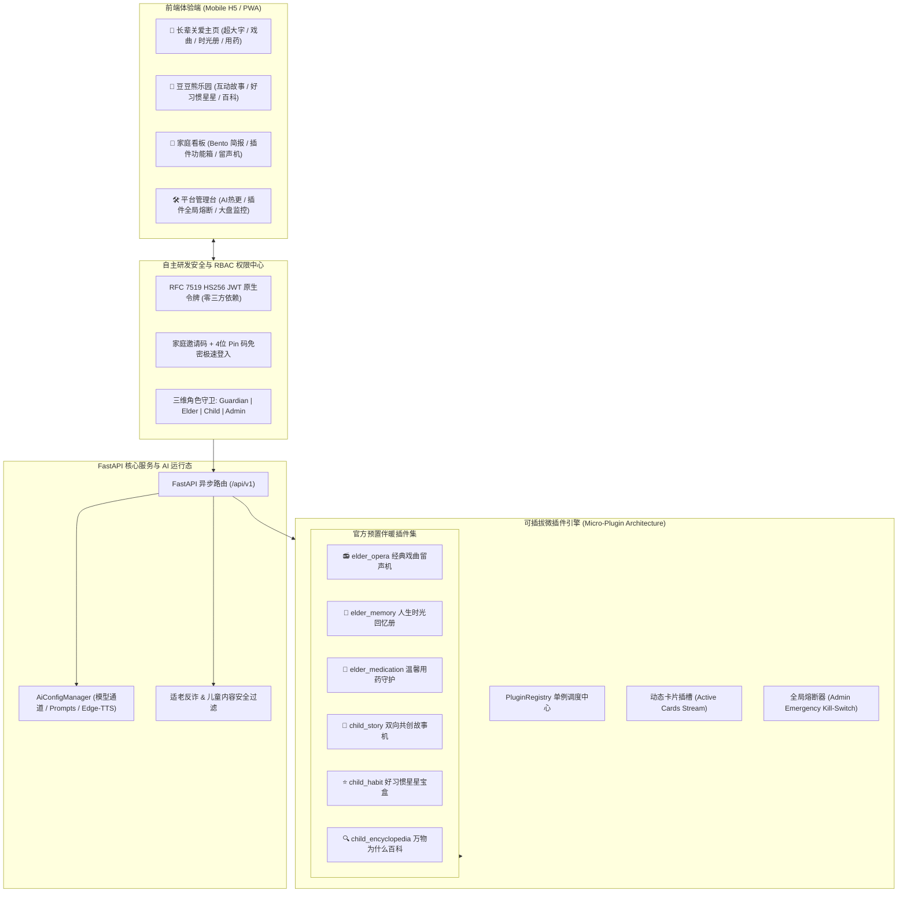

# 「伴暖」WarmCompanion · 家庭一老一小双模温情陪伴平台

<div align="center">


**面向现代家庭的轻量级一老一小双向温情陪伴与智能看护平台**  
*语音优先 · 适老化超大字 · 双向互动童趣 · 可插拔微插件 · 全域安全中控*

[🔑 独立登录与注册门户](prototype/login.html) · [📱 手机端体验原型](prototype/index.html) · [🛠️ 平台管理控制台](prototype/admin.html) · [📖 产品需求文档 (PRD)](docs/PRD_FAMILY_COMPANION.md)

</div>

---

## 📖 项目愿景与背景

随着现代家庭工作与生活节奏加快，核心中青年群体的双向照料压力剧增：
- **银发长辈**：独自居家、缺乏倾诉交流、容易遗漏慢病用药、视力听力衰退、对复杂菜单有天然畏难心理；
- **幼童宝贝**：渴望耐心睡前故事与好奇心百科解答、需要好习惯正向引导激励、对网络有害内容高度敏感；
- **家庭守护者**：工作繁忙，亟需轻量低干扰、高价值的每日老幼陪伴全景简报，并能随时远程留言与配置提醒。

**「伴暖」(WarmCompanion)** 采用 **Python (FastAPI) 异步后端 + 响应式 Mobile-First Web** 架构，通过出生年月日自适应锁定单身份，为银发长辈和幼童宝贝打造零门槛、无障碍、沉浸式的陪伴空间，并提供家庭中控看板与平台级运营管理后台。

---

## 🌟 核心功能特色

### 1. 👵 银发长辈关爱端 (Elder Care Mode)
- **适老化高对比排版**：默认 20px+ 大字体（支持一键切换特大字）、1.6 倍舒适行高、WCAG AAA 级暖深棕字底比（$\ge 7:1$）；
- **语音优先单手对讲**：常驻 64px 大拇指盲操对讲岛，配合 0.85x 低频温和语速朗读与实时声波反馈；
- **经典戏曲黑胶留声机 (`elder_opera`)**：内置黄梅戏《女驸马》、豫剧《花木兰》、京剧《梨花颂》等名段，黑胶旋转微动效与大字唱词同步念白；
- **人生时光回忆册 (`elder_memory`)**：晚辈 AI 主动抛出温情老话题，耐心倾听长辈口述过往故事并永久沉淀为家庭口述史；
- **伴随式用药守护 (`elder_medication`)**：告别冰冷闹钟，打卡伴随清脆正向反馈音效，支持女儿晨间亲情便签联动；
- **紧急求助大按键**：底部醒目红底大按键，支持一键直达呼叫紧急联系人。

### 2. 👶 童趣启蒙成长端 (Kids Play Mode)
- **护眼童趣视觉**：柔和马卡龙天空蓝与暖阳橙配色，大圆角趣味卡片（`radius: 24px`），杜绝高饱和度刺眼蓝光；
- **豆豆熊双向分幕共创故事机 (`child_story`)**：改变传统单向被动听故事，每幕结束浮出二选一互动分支胶囊（如“降落棉花糖城堡” vs “穿过彩虹桥”），由孩子决定故事走向，AI 即时接续讲完；
- **好习惯星星挑战箱 (`child_habit`)**：将刷牙、喝牛奶、按时作息拆解为星星任务，每完成一项点亮金星，集齐 3 颗点亮【晚安小勇士勋章】；
- **万物为什么奇妙百科 (`child_encyclopedia`)**：针对彩虹、小鸟树枝睡觉、月亮跟随等童年常见问题，采用拟人童趣比喻解答与语音播报；
- **防沉迷保护**：21:00 睡前故事机自动切入舒缓静音模式，保护孩子视力与作息健康。

### 3. 🏡 家庭守护者看板 (Family Dashboard)
- **30 秒温情看护全景简报 (Bento Grid)**：分格直观呈现长辈今日心情指数、用药打卡时间，以及孩子习惯星星收集与故事进度；
- **亲情留声机便签互投**：守护者在手机端录制或键入留言便签，一键投递为长辈与孩子主界面中的温馨“亲情彩蛋”；
- **🧩 伴暖家庭插件功能箱**：守护者可在家庭后台自由开关老人与孩子的专属功能卡片流（戏曲、时光册、故事机等）。

### 4. 🛠️ 平台超级管理控制台 (Admin Control Center)
- **全景监控大盘**：实时监管平台已入驻家庭总数、在护老人/儿童规模、今日 AI 对话调用频次与健康指数；
- **AI 大模型服务商与人设热更**：支持 DeepSeek-V3 / 通义千问 Qwen 2.5 / OpenAI / Mock 通道秒级热切换，支持在线微调系统提示词 (Prompt)、发散度 (Temperature) 与 Token 限制；
- **Edge-TTS 拟人语音调度**：长辈端温润音色 (`zh-CN-YunyangNeural`, -15% 慢速) 与儿童端甜美音色 (`zh-CN-XiaoyiNeural`, +5% 语速) 独立微调；
- **全局紧急熔断机制 (Kill-Switch)**：突发插件故障或内容合规风险时，管理员可一键全局熔断，全网各家庭端卡片即刻下线并禁止调用；
- **安全审计日志**：全链路适老防诈骗敏感词拦截与儿童有害内容净化记录实时追踪。

---

## 🏗️ 核心架构与工程设计



### 1. 工业级 PyJWT 与 Sa-Token 协议 30 天持久会话体系
- **工业级 PyJWT 内核**：采用 Python 社区事实标准 `PyJWT` 提供标准 RFC 7519 HS256 JWT 签发与完整性校验；
- **30 天超长会话保障**：默认签发有效期达 `30 天`（`2,592,000` 秒），彻底避免老人和儿童因频繁掉线需重新登录的痛点；
- **Sa-Token 协议双通道 Header 兼容**：原生支持 `satoken: <token>`（Sa-Token 规范）与 `Authorization: Bearer <token>`（RFC 规范）双模式解析；
- **PBKDF2-HMAC-SHA256**：密码存储采用 100,000 次加盐迭代哈希，恒定时间比对防御时序攻击；
- **Pin 码免密极速入家**：长辈与儿童设备只需输入【6 位家庭邀请码 + 4 位简易 Pin 码】，即可一键换取专属 30 天凭据，破除密码与短信门槛。

### 2. 可插拔微插件架构 (Micro-Plugin Architecture)
- 每个功能卡片均为继承 `BasePlugin` 的独立单元，强约束声明 `PluginManifest`；
- 前端告别死板静态 DOM，统一通过 `/api/v1/plugins/active` 动态下发当前角色启用的卡片流；
- 严格 RBAC 隔离：长辈调用儿童故事或儿童调用长辈用药均被 `403 Forbidden` 拦截；
- 具备“家庭级按需启停”与“平台级全局一键熔断”双层管控机制。

---

## 📁 目录组织结构

```text
tiancode/
├── backend/
│   ├── app/
│   │   ├── main.py                 # FastAPI 入口：挂载路由、/healthz /readyz、托管原型
│   │   ├── api/
│   │   │   ├── deps.py               # JWT 身份依赖、RBAC 角色守卫、require_admin
│   │   │   └── v1/
│   │   │       ├── auth.py           # 守护者注册/登录、家庭纳管、Pin 码免密登录
│   │   │       ├── plugins.py        # 动态卡片流拉取、插件动作分发、家庭插件开关
│   │   │       └── admin.py          # 管理员登录、AI 模型热更、插件全局熔断、大盘统计
│   │   ├── core/
│   │   │   ├── security.py           # 原生零外部依赖 RFC 7519 JWT 与 PBKDF2 哈希
│   │   │   └── ai_config.py          # AI 大模型通道、Prompt 人设与 TTS 语速单例管理器
│   │   ├── plugins/
│   │   │   ├── base.py               # 插件抽象基类规范 (BasePlugin)
│   │   │   ├── registry.py           # 插件注册中心 (单例、角色过滤、全局熔断)
│   │   │   ├── loader.py             # 预置插件自动装载器
│   │   │   ├── builtin_elder.py      # 长辈插件集 (戏曲留声机、时光册、用药打卡)
│   │   │   └── builtin_child.py      # 儿童插件集 (双向故事机、星星宝盒、奇妙百科)
│   │   └── schemas/
│   │       ├── auth.py               # 认证请求/响应模型与 UserRole (guardian/elder/child/admin)
│   │       ├── plugin.py             # PluginManifest、CardTemplateType、动作契约
│   │       └── admin.py              # AI 配置热更契约、大盘指标统计模型
│   └── tests/
│       ├── test_main_health.py       # /healthz、原型页、ROOT_PATH 不改写路由
│       ├── test_auth_unit.py         # JWT 签名、验签、篡改防御、过期拦截单元测试
│       ├── test_auth_api.py          # 守护者建家、纳管成员、Pin 免密登录与 RBAC 越权拦截
│       ├── test_plugins_api.py       # 插件角色白名单过滤、切歌/分支动作与家庭开关测试
│       └── test_admin_api.py         # 管理员认证、AI 参数热更、插件全网紧急熔断联动测试
├── deploy/
│   ├── docker-compose.yml            # 单 api 服务，127.0.0.1:8092→8000
│   ├── .env.example                  # JWT / 管理员占位，无真实密钥
│   └── nginx/
│       └── gateway-tiancode.conf.example
├── docs/
│   ├── PRD_FAMILY_COMPANION.md       # 伴暖完整产品需求文档 (PRD)
│   └── deploy.md                     # Jenkins 部署说明
├── prototype/
│   ├── login.html                    # 独立温情认证中心 (守护者手机注册/登录 + 老幼大字 Pin 免密入家)
│   ├── index.html                    # 移动端一老一小双模陪伴与家庭看板交互原型
│   └── admin.html                    # 现代化 Enterprise SaaS 平台管理控制台中枢
├── Dockerfile
├── Jenkinsfile
├── pyproject.toml
├── .gitignore
└── README.md
```

---

## 🚀 快速上手与运行体验

### 1. 交互原型秒开体验 (无需任何运行环境)
- **独立登录与注册门户**：使用浏览器直接打开 [`prototype/login.html`](prototype/login.html)
  - 体验守护者手机号/密码注册与建家，或长辈/儿童 6 位家庭码 + 4 位大方格 Pin 码免密极速进入；
  - 登录成功激活 Sa-Token 协议 30 天持久免登会话，并平滑转跳至主页；
- **老幼陪伴与家庭看板移动端原型**：使用手机或电脑浏览器直接打开 [`prototype/index.html`](prototype/index.html)
  - 初次进入通过出生年月日自适应锁定身份；
  - 体验大字戏曲旋转播报、双向故事分幕二选一、好习惯星星点亮与 Pin 码快速登录；
- **平台超级管理控制台**：使用浏览器直接打开 [`prototype/admin.html`](prototype/admin.html)
  - 体验全景监控指标、大模型 Provider 实时热切换、Edge-TTS 音色微调以及插件全局紧急熔断开关。

启动 API 后，同一套页面也在 `/` 与 `/admin.html`。

### 2. 后端服务运行与测试验证
运行环境要求：**Python 3.11+**（已在 Python 3.12 验证）。依赖在仓库根目录 `pyproject.toml`。

```bash
python3 -m venv .venv && . .venv/bin/activate
pip install -e '.[dev]'
pytest -q
export JWT_SECRET="$(openssl rand -hex 32)"
export ADMIN_USERNAME=admin
export ADMIN_PASSWORD="$(openssl rand -base64 24)"
uvicorn app.main:app --host 127.0.0.1 --port 8000
```

`JWT_SECRET` 至少 32 个字符，`ADMIN_PASSWORD` 至少 12 个字符。未设置，或仍等于仓库里的占位符（`tiancode-family-secret-32-bytes-min!`、`AdminPassword123!`、`change-me`、`change-me-openssl-rand-hex-32`），进程会在启动时拒绝服务。模板见 [deploy/.env.example](deploy/.env.example)。pytest 自己注入测试密钥，不需要先 export。

健康检查：`/healthz`、`/readyz`。

家庭账号没有预置数据。守护者通过 `POST /api/v1/auth/register` 建家，再 `POST /api/v1/family/members` 纳管长辈或儿童。创建成员的响应会一次性返回 Pin；之后只保存哈希。平台管理员只走 `POST /api/v1/admin/login`，账号密码来自上面的环境变量。

### 3. 练习机部署
公开路径是 `http://<HOST>/tiancode/`，API 只监听 `127.0.0.1:8092`。凭据 ID、nginx 片段和 `docker restart nginx-gw` 见 [docs/deploy.md](docs/deploy.md)。

---

## 🔑 登录入口

| 角色 | 接口 | 凭证从哪来 |
| :--- | :--- | :--- |
| 平台管理员 | `POST /api/v1/admin/login` | 环境变量 `ADMIN_USERNAME` / `ADMIN_PASSWORD` |
| 家庭守护者 | `POST /api/v1/auth/register` 然后 `POST /api/v1/auth/login` | 请求里的手机号和密码。注册成功的响应带家庭邀请码 |
| 长辈 / 儿童 | `POST /api/v1/auth/member-login` | 邀请码 + 纳管时一次性返回的 Pin。角色只能是 `elder` 或 `child` |

`prototype/login.html` 仍是本地演示页，不会调用上述接口。

---

## 📄 开源与版权许可

本项目遵循 [MIT License](LICENSE) 开源许可协议。欢迎家庭关爱开发者、适老化软硬件爱好者以及智慧家庭生态伙伴共同交流与共建！
