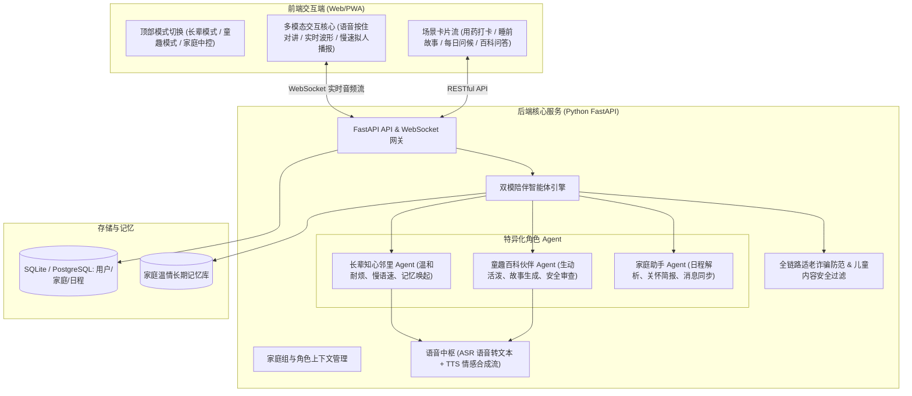

# 「伴暖」WarmCompanion · 家庭一老一小双模陪伴平台 PRD

## 一、 产品愿景与定位

### 1.1 背景与定位
随着现代家庭工作节奏加快，核心中青年群体的双向看护压力巨大：一边是独自居家的银发长辈（缺乏倾诉、容易漏药、视力衰退、对复杂电子产品有畏难情绪），另一边是渴望陪伴启蒙的幼童（需要耐心睡前故事、好奇心百科问答、情绪疏导）。
**「伴暖」(WarmCompanion)** 是一款面向家庭 Web 端的轻量级 AI 温情陪伴平台，通过**“长辈关爱”**与**“童趣启蒙”**双模式自适应切换，以**语音优先、零门槛、无障碍适老化与高安全童趣**为核心，帮助家庭构建跨代际的温暖纽带。

### 1.2 目标群体画像

| 角色 | 年龄段 | 核心诉求 | 关键心理特征 |
| :--- | :--- | :--- | :--- |
| **银发长辈** | 60+ 岁 | 日常唠嗑解闷、用药就医定时提醒、听戏与养生常识、子女留言 | 畏惧复杂菜单、视力与听力弱化、希望被重视和耐心倾听 |
| **幼童** | 3 - 8 岁 | 睡前童话、角色扮演游戏、百科好问解答、好习惯打卡 | 依赖生动声效与视觉绘本、注意力时间短、对内容安全极度敏感 |
| **家庭守护者** | 25 - 45 岁 | 远程了解长辈与孩子当日陪伴动态、配置提醒日历、查看温情简报 | 工作繁忙、需要低干扰、高价值的每日看护摘要 |

---

## 二、 产品架构与核心流程

---

## 三、 功能规格与模块说明

### 3.0 初始引导：出生年月日感知与模式自适应 (Onboarding & Age-Adaptive)
- **初始年月日录入流程**：
  - 用户初次进入平台时，优先呈现温情轻量引导弹层，引导输入或选择出生年月日（年-月-日）。
  - 针对手机端优化原生 DatePicker 调起，支持一键选取，同时提供便捷预设。
- **智能年龄测算与模式映射**：
  - $\ge 60$ 岁（银发长辈）：自动推荐并切换至【长辈关爱模式】（超大字体、慢速朗读、用药提醒、戏曲点播）。
  - $\le 12$ 岁（幼童）：自动推荐并切换至【童趣启蒙模式】（萌趣玩伴、睡前绘本故事、好习惯打卡）。
  - 13 ~ 59 岁（家庭守护者）：推荐进入【家庭中控看板】（看护老幼日报、远程用药配置）。
- **动态修改与状态常驻**：
  - 顶部导航栏常驻“🎂 年龄/角色胶囊”，用户可随时点击重新调整生日，支持跨模式无缝热重载。

### 3.1 模块一：双模式无障碍沉浸陪伴

#### 3.1.1 长辈关怀模式 (Elder Care Mode)
- **视觉适老化**：
  - 默认 20px+ 大字号、1.6 倍行高、符合 WCAG AAA 级的超高对比度配色（暖深棕字底比 $\ge 7:1$）。
  - 去除层级多深的二级菜单，一屏到底，关键按钮触控热区 $\ge 64 \times 64\text{px}$。
- **忆苦思甜·人生时光册 (Memory Keeper)**：
  - **心理机制**：长辈最渴望被倾听与回忆过往。AI 扮演晚辈主动抛出老话题（“外婆，您年轻时那会儿做针线活手艺一定特别好吧？聊聊呗！”）。
  - **口述生成**：长辈按住一键录音口述，AI 耐心倾听并转录归纳为“家史回忆卡片”，支持子女远程翻阅与大字重温。
- **经典戏曲留声机 (Opera Player)**：
  - 内置黄梅戏《女驸马》、豫剧《花木兰》、京剧《梨花颂》等经典名段。
  - 黑胶旋转微动效、上一首/下一首大触控、大字唱词同步念白与慢速播放。
- **伴随式温情用药守护**：
  - 告别冰冷闹钟提醒，打卡伴随清脆正向反馈音效（“好样的外婆！健康打卡完成啦！”）。
  - 亲情语音彩蛋联动：女儿留的温馨便签在早晨服药时提醒收听。
- **醒目亲情直达与紧急大按键**：
  - 底部常驻 56px 醒目红底大按键：“📞 一键呼叫女儿 (小敏) · 紧急留言”，防迷路、防慌乱。

#### 3.1.2 童趣启蒙模式 (Kids Play Mode)
- **视觉童趣与护眼**：
  - 柔和马卡龙色调（避免高饱和度刺眼蓝光）、大圆角卡片、萌趣手绘风格动效。
- **豆豆熊双向共创故事机 (Interactive Story Machine)**：
  - 改变传统单向被动听故事，采用**“分幕互动决策”**：第 1 幕讲完后，屏幕浮出二选一分支胶囊（如“A. 降落棉花糖城堡” vs “B. 穿过彩虹桥找星星”），由孩子决定故事走向，AI 豆豆熊实时动态接续讲完并朗读。
- **好习惯星星挑战箱 (Habit Gamification)**：
  - 将刷牙、喝牛奶、按时作息拆解为 3 颗小星星，每完成一项点亮一颗星，集齐 3 颗星点亮弹出【晚安小勇士】勋章，培养作息规律。
- **万物为什么·奇妙百科**：
  - 针对彩虹、小鸟树枝睡觉、月亮跟随等孩子常见问题，采用拟人童趣比喻解答，一键语音播报。
- **亲情留言彩蛋**：
  - 爸爸妈妈在外地录制的晚安语音，在故事机结束后作为温馨彩蛋呈现。

#### 3.1.3 家庭中控看板 (Family Dashboard)
- **30秒温情看护全景简报 (Bento Grid)**：
  - 极简分格 Bento 布局：长辈今日心情指数（5星）、对讲时长、降压药打卡时间；孩子习惯星星进度（2/3）、睡前故事幕次。
- **亲情留声机 (Family Voice Memo Box)**：
  - 子女可在手机端一键录制或键入语音留言（“妈，今天降温多穿件马甲”或“宝贝，今天表现真棒”），一键投递至长辈与孩子的主界面。
- **远程配置与防沉迷**：
  - 远程添加长辈服药计划与就医提醒日历；
  - 睡前 21:00 故事机自动切入静音舒缓模式，保护孩子视力与作息。

---

## 四、 页面与交互状态定义 (符合 UI/UX Pro Max 规范)

| 组件 | Default 默认态 | Hover / 激活反馈 | 交互与无障碍细节 |
| :--- | :--- | :--- | :--- |
| **戏曲黑胶留声机** | 黑胶静止，展示曲名与唱词 | 点击播放：黑胶平滑旋转，慢速朗读唱词 | 触感微震动 25ms，上一首/下一首大触控区 |
| **互动故事分支胶囊** | 柔和天蓝边框卡片 | 点击悬浮上浮 3px，高亮天蓝，豆豆熊接讲下幕 | 适合儿童手指点击，字体 16px 加粗 |
| **好习惯星星打卡** | 灰色圆圈，提示打卡任务 | 点击点亮金黄小星星，弹出清脆提示音与微震动 | 集齐 3 颗星触发彩带与【晚安小勇士】勋章 |
| **亲情语音便签横幅** | 柔和橙色暖底，带小信封图标 | 点击播放亲人温暖原声语音 | 移动端触感震动反馈，支持一键重听 |
| **中央语音对讲岛** | 柔和呼吸光晕，麦克风图标 | 按住产生音频涟漪波形，提示“正在倾听...” | 单手大拇指大盲操区，适老化与儿童无门槛 |
| **紧急红色呼叫按钮** | 高对比度醒目红底，电话图标 | 按下微缩小并伴随震动，一键拨号 | 64px 极醒目热区，长辈防丢防摔倒应急保障 |

---

## 五、 技术架构选型与路线 (方案 B)

1. **前端工程**：
   - 现代响应式 Web SPA（HTML5 + Tailwind CSS + Vue 3 / 原生轻量组件）。
   - 完全离线支持（PWA Service Worker），支持加到手机/平板主屏幕即当原生 App 使用。
   - 适配 Web Speech API（或集成服务端流式 ASR/TTS）。
2. **后端工程 (Python)**：
   - **框架**：FastAPI（高性能异步微框架，天然支持 Async 流式响应与 WebSocket）。
   - **大模型驱动**：LangChain / LiteLLM，支持接入 DeepSeek-V3 / Qwen 等高性价比大模型。
   - **语音与多模态**：对接 Edge-TTS（高品质免费拟人音色）或开源 Whisper/CosyVoice。
   - **数据库**：轻量级 SQLite（开发与初版），可平滑无缝升级至 PostgreSQL。
