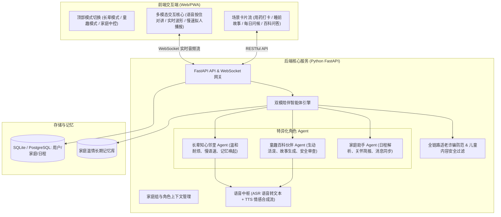

# 「伴暖」WarmCompanion · 家庭一老一小双模陪伴平台 PRD

## 一、 产品愿景与定位

### 1.1 背景与定位
随着现代家庭工作节奏加快，核心中青年群体的双向看护压力巨大：一边是独自居家的银发长辈（缺乏倾诉、容易漏药、视力衰退、对复杂电子产品有畏难情绪），另一边是渴望陪伴启蒙的幼童（需要耐心睡前故事、好奇心百科问答、情绪疏导）。
**「伴暖」(WarmCompanion)** 是一款面向家庭 Web 端的轻量级 AI 温情陪伴平台，通过**“长辈关爱”**与**“童趣启蒙”**双模式自适应切换，以**语音优先、零门槛、无障碍适老化与高安全童趣**为核心，帮助家庭构建跨代际的温暖纽带。

### 1.2 目标群体画像

| 角色 | 年龄段 | 核心诉求 | 关键心理特征 |
| :--- | :--- | :--- | :--- |
| **银发长辈** | 60+ 岁 | 日常唠嗑解闷、用药就医定时提醒、听戏与养生常识、子女留言 | 畏惧复杂菜单、视力与听力弱化、希望被重视和耐心倾听 |
| **幼童** | 3 - 8 岁 | 睡前童话、角色扮演游戏、百科好问解答、好习惯打卡 | 依赖生动声效与视觉绘本、注意力时间短、对内容安全极度敏感 |
| **家庭守护者** | 25 - 45 岁 | 远程了解长辈与孩子当日陪伴动态、配置提醒日历、查看温情简报 | 工作繁忙、需要低干扰、高价值的每日看护摘要 |

---

## 二、 产品架构与核心流程

---

## 三、 功能规格与模块说明

### 3.1 模块一：双模式无障碍沉浸陪伴

#### 3.1.1 长辈关怀模式 (Elder Care Mode)
- **视觉适老化**：
  - 默认 20px+ 大字号、1.6 倍行高、符合 WCAG AAA 级的超高对比度配色（暖深棕字底比 $\ge 7:1$）。
  - 去除层级多深的二级菜单，一屏到底，关键按钮触控热区 $\ge 64 \times 64\text{px}$。
- **语音全接管**：
  - 屏幕正下方常驻“按住说话 / 点击对讲”大按钮，带触感波形与听觉声响反馈。
  - AI 回复时默认采用低频、温暖、字正腔圆的慢速播报（支持 0.8x/1.0x 调速），文字逐字高亮同步展示。
- **长辈特定内容库**：
  - 老歌戏曲点播、节气与养生常识、老故事倾听回味。

#### 3.1.2 童趣启蒙模式 (Kids Play Mode)
- **视觉童趣与护眼**：
  - 柔和马卡龙色调（避免高饱和度刺眼蓝光）、大圆角卡片、萌趣手绘风格动效。
- **互动绘本与故事机**：
  - “今天想听什么故事”：支持根据孩子输入的兴趣角色（如“小兔子在月亮上探险”）即时生成图文并茂的短篇分幕故事。
  - “万物为什么”：用拟人化、浅显易懂的比喻回答自然科学常识。
- **严苛安全屏障**：
  - 实时过滤暴力、消极、敏感内容，自动引导正面价值观与睡前作息规律。

#### 3.1.3 家庭中控看板 (Family Dashboard)
- **关怀状态总览**：
  - 今日长辈聊天状态（如：“外婆今天聊了 15 分钟年轻时的故事，心情愉悦”）。
  - 用药打卡状态：“降压药已在 08:30 确认打卡”。
  - 孩子睡前故事：“已于 21:00 听完《月亮小兔》，已进入休息时间”。
- **远程配置**：子女可远程添加用药计划、录制亲情语音留言。

---

## 四、 页面与交互状态定义 (符合 UI/UX Pro Max 规范)

| 组件 | Default 默认态 | Hover 悬停态 | Active 按压态 | 交互与无障碍细节 |
| :--- | :--- | :--- | :--- | :--- |
| **中央语音对讲球** | 柔和微呼吸光晕，麦克风图标 | 光晕扩散，提示“点击或按住对讲” | 动态音频声波扩散，高亮提示“正在倾听...” | 支持空格键快捷触发，长辈模式声波震颤清晰 |
| **模式切换胶囊** | 长辈/童趣/家庭三段式无缝药丸 | 悬停卡片上浮 1px，微弱高亮 | 平滑平移滑动过渡 | 切换时自动切换全站主题变量与字号层级 |
| **日程提醒打卡卡片** | 清晰显示药品名称/时间/复选圈 | 边缘微光浮起 | 勾选动画：绿色对勾绽开并伴随清脆提示音 | 逾期未打卡标红加粗，长辈模式可一键语音报备 |
| **AI 消息气泡** | 柔和卡片背景，左侧伴有卡通/亲切头像 | 浮现“重新朗读”和“收藏便签”按钮 | 点击朗读按钮触发语音波形 | 长辈模式正文 22px，支持大字单栏排版 |

---

## 五、 技术架构选型与路线 (方案 B)

1. **前端工程**：
   - 现代响应式 Web SPA（HTML5 + Tailwind CSS + Vue 3 / 原生轻量组件）。
   - 完全离线支持（PWA Service Worker），支持加到手机/平板主屏幕即当原生 App 使用。
   - 适配 Web Speech API（或集成服务端流式 ASR/TTS）。
2. **后端工程 (Python)**：
   - **框架**：FastAPI（高性能异步微框架，天然支持 Async 流式响应与 WebSocket）。
   - **大模型驱动**：LangChain / LiteLLM，支持接入 DeepSeek-V3 / Qwen 等高性价比大模型。
   - **语音与多模态**：对接 Edge-TTS（高品质免费拟人音色）或开源 Whisper/CosyVoice。
   - **数据库**：轻量级 SQLite（开发与初版），可平滑无缝升级至 PostgreSQL。
